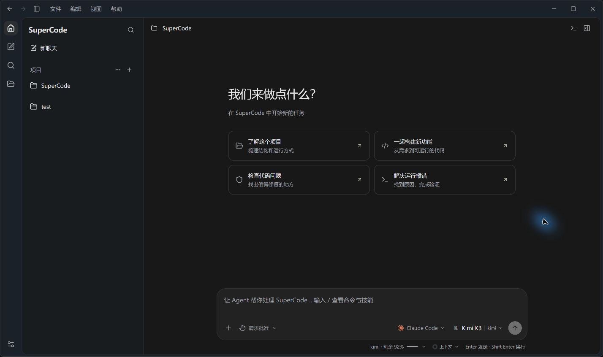
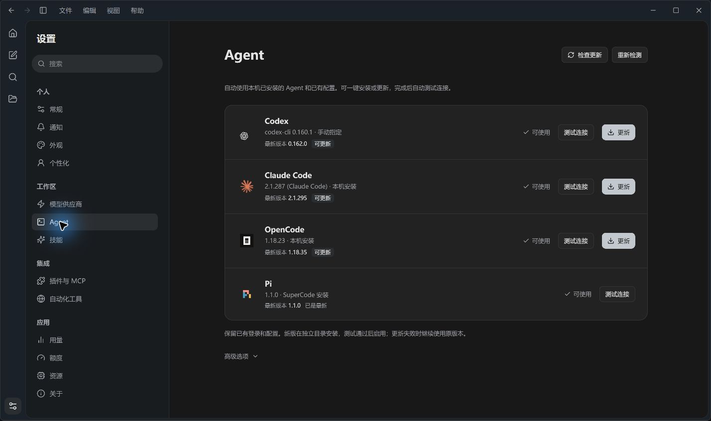

# SuperCode

把 Codex、Claude Code、OpenCode 和 Pi 放进一个桌面工作台，管理项目、模型连接和工具，直接用对话完成开发任务。

当前版本 **0.2.0**，主要支持 **Windows**。基于 Tauri 2、Rust、React + TypeScript 和 SQLite。

[下载 Windows 安装包](https://github.com/heyule69/SuperCode/releases/latest) · [版本记录](https://github.com/heyule69/SuperCode/releases)



## 功能

- **Agent 管理**：自动发现本机 Agent，显示已安装和最新版本，支持一键安装、更新与连接测试。
- **模型连接**：Codex、Claude 官方多账号登录，按 Agent 配置 API 协议，支持从 CC Switch 导入连接。
- **对话工作台**：流式回复、工具记录、文件差异、历史会话和侧边聊天；任务运行中可以追加消息、排队或引导。
- **图片与媒体**：上传、粘贴图片，在对话中查看图片、播放视频和音频。
- **技能、插件与 MCP**：发现本机技能，管理 Codex / Claude 插件和 MCP；内置浏览器、电脑操作，支持连接测试和随时接管。
- **内置浏览器与电脑操作**：在右侧查看网页操作过程，浏览器与文件变更独立显示；电脑操作带屏幕光效和 AI 指针，按 Esc 或直接操作即可接管。
- **桌面体验**：深浅主题、系统通知、托盘和多窗口。聊天保存在本机，Agent 按需启动，空闲后释放。
- **软件更新**：自动检查 GitHub Releases，在「设置 → 关于」下载更新并重启安装，保留聊天与配置。

Codex、Claude Code、OpenCode、Pi 均支持多个聊天同时运行，同一种 Agent 也可并行开启多个会话，没有应用设置的 Agent 数量或任务并发上限。各聊天独立处理停止、审批和输出；向同一个活动聊天追加消息时，按原生能力引导或按该聊天的顺序发送。

## 开始使用

先下载安装包，选择安装目录。之后可直接在软件中更新。

1. 在「设置 → Agent」检测已有安装，缺少时点击「安装」。
2. 在「模型供应商」选择官方账号登录，或添加 API 连接。
3. 选择 Agent 和模型，输入任务即可。项目可选；未选择时，聊天文件保存在文档目录的 `SuperCode` 文件夹中。

已有 Agent 的登录和配置会继续使用。下载与更新使用独立目录，测试通过后再启用。

## 界面截图

**Agent 管理**



## 排查异常

软件启动后自动保存诊断日志，无需手动开启。在「查看 → 运行日志」或聊天顶部的终端图标打开日志面板，点击「打开文件夹」查看文件，或「导出诊断日志」收集最近 30 天的记录。「清空显示」只清空面板，不删除文件。

Windows 日志目录为 `%APPDATA%\dev.supercode.desktop\logs`。日志按日期保存为 UTF-8 JSONL，每个分段最多 4 MiB，启动时及运行期间每小时清理超过 30 天的日志。记录包含版本、时间、会话 ID、Agent、任务状态、进程退出、错误输出、上下文压缩和浏览器/界面异常；API 密钥、认证令牌等会在写入前脱敏，不主动记录对话正文。

如果另一台设备出现自动停止，请在该设备导出日志，并告知出现问题的大致时间，以便对应任务和进程记录。

## 从源码运行

准备 Node.js 22+、Rust、Windows C++ Build Tools 和 WebView2。

```powershell
git clone https://github.com/heyule69/SuperCode.git
cd SuperCode
npm ci
npm run desktop
```

```powershell
npm run build                                      # 构建前端
npm test                                           # 前端测试
cargo test --manifest-path src-tauri/Cargo.toml      # Rust 测试
npm run desktop:build                              # 打包桌面端
npm run installer:build                            # 构建 Logo 动画安装器
```

安装器构建还需要 Python 与 NSIS，详见 [安装器说明](installer/README.md)。
