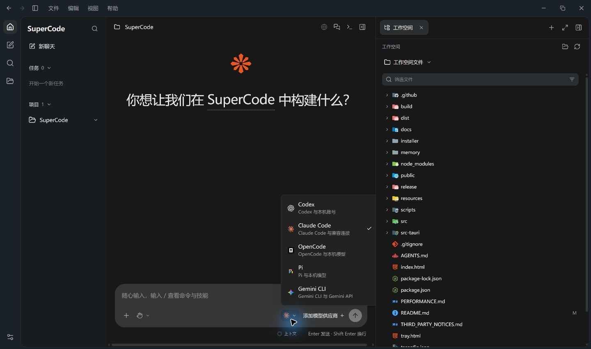
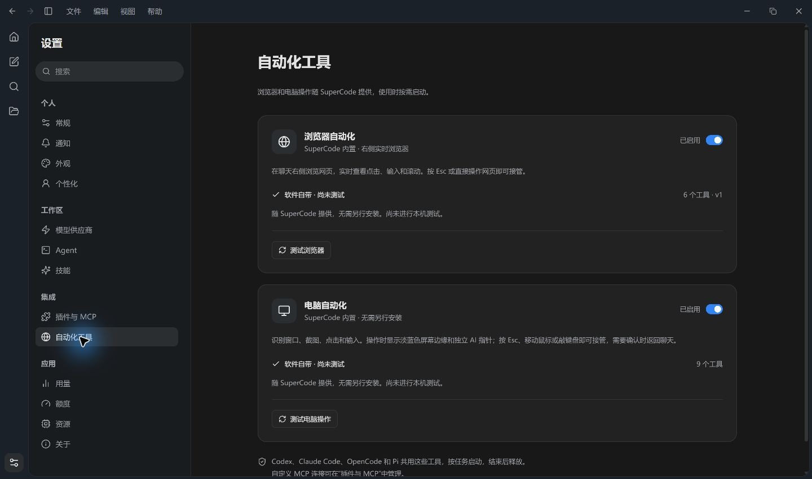
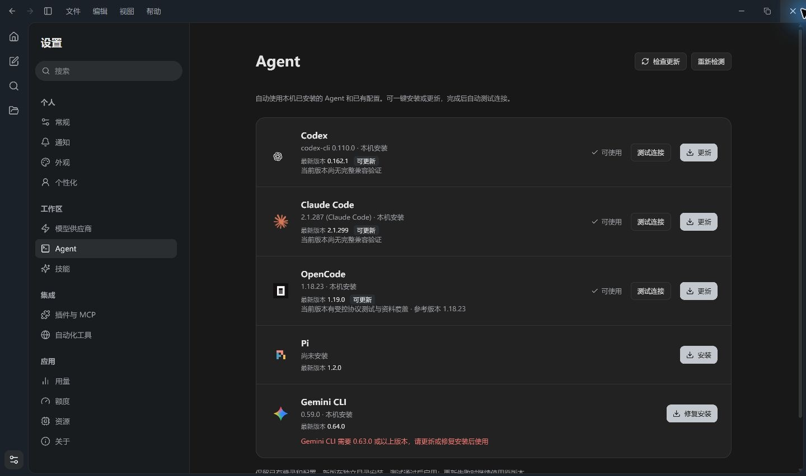

# SuperCode

一个轻量、本地优先的多 Agent 编程桌面工作台。把 **Codex、Claude Code、OpenCode、Pi 和 Gemini CLI** 放进同一个界面，管理项目、模型连接与工具，用对话完成开发任务。

当前版本 **0.2.7**，主要支持 **Windows**。桌面核心采用 Rust + Tauri 2，前端采用 React + TypeScript，聊天与配置保存在本机 SQLite 数据库中。

[下载 Windows 安装包](https://github.com/heyule69/SuperCode/releases/latest) · [版本记录](https://github.com/heyule69/SuperCode/releases) · [反馈问题](https://github.com/heyule69/SuperCode/issues)



以下截图来自 0.2.5 桌面版。

## 开始使用

1. 下载 Windows 安装包，选择安装目录并完成安装。
2. 打开「设置 → Agent」，检测已有 Agent；缺少时点击「安装」，等待连接测试通过。
3. 打开「设置 → 模型供应商」，选择官方账号登录，或添加 API 连接。
4. 新建聊天，选择 Agent、连接、模型和权限，输入任务。

可以选择已有代码文件夹作为项目，也可以直接开始聊天。未选择项目时，首次发送任务会在文档目录的 `SuperCode` 文件夹中创建独立工作目录。

发布版无需预先安装 Node.js 或 Rust 开发环境。SuperCode 可为 Agent 准备独立运行环境；使用模型所需的账号或 API 连接由你配置。

### 支持的 Agent 与连接

| Agent | 官方账号 | API 接入协议 |
| --- | --- | --- |
| Codex | ChatGPT 登录，支持多个账号 | OpenAI Responses |
| Claude Code | Claude 登录，支持多个账号 | Anthropic Messages |
| OpenCode | — | Anthropic Messages、OpenAI Responses、OpenAI Chat Completions、Gemini API |
| Pi | — | Anthropic Messages、OpenAI Responses、OpenAI Chat Completions、Gemini API |
| Gemini CLI | 当前不继承本机 Google OAuth 登录 | Gemini API，支持 API Key 与兼容网关 |

五种 Agent 均通过各自原生协议运行，支持独立聊天、流式输出、工具活动、停止与会话恢复。计划、子代理、思考摘要、图片输入和运行中引导等能力，取决于引擎版本、模型和接口。

Gemini CLI 要求 **0.63.0 或以上版本**。0.2.5 已通过官方 CLI 0.63.0 的本机隔离网关验证与受控 ACP 测试，真实供应商仍需实际使用验证；该参考版本的 ACP 暂不提供原生结构化追问。Gemini 连接测试使用实际 CLI 引擎，在独立进程中执行。

## 主要功能

### 对话、计划与子代理

- 流式显示回复、引擎公开的思考摘要、工具参数、命令输出、文件差异、审批和提问；区分运行、等待确认、完成、失败与停止。
- 任务运行时可继续补充消息，选择引导当前任务或排队到下一轮；待发送消息可编辑、删除。引导的生效时机按原生能力处理，部分引擎或版本会先停止当前轮再续聊。
- 查看原生计划文档，选择执行或继续修改；Codex 支持设置持续推进的目标，并可指定 Token 预算。
- 子代理有独立图标、任务摘要和详情面板，工具输出按需展开；可使用侧边聊天继续提问。
- 每个聊天独立保存草稿，支持重启恢复与跨窗口同步；`/` 菜单提供界面操作及当前引擎可用的原生命令。

### 项目、文件与代码改动

- 管理多个项目与历史聊天，支持搜索、重命名、置顶、自定义分区、归档与恢复。
- 将聊天分叉到当前目录或其他项目，在独立窗口中打开，或导出为 HTML / Markdown 文件分享。
- 在工作空间浏览文件、查看 Git 变更和每轮代码改动；代码与差异支持语法高亮和行号。
- 聊天中明确引用的文件可预览、系统打开或在文件夹中定位，支持绝对路径、相对路径和文件链接。
- 右侧工作空间、计划、浏览器、代码改动、侧边聊天与子代理分别使用标签，可切换、关闭和调整面板宽度。

### 模型连接与权限

- 提供多个供应商和本地服务预设，区分 Coding Plan 与标准 API；支持自定义地址、协议、密钥与模型。
- Codex / Claude 官方账号可独立登录、重命名和设置默认账号；模型菜单显示实际模型 ID。
- 自定义连接填写地址、协议和 Key 后即可获取模型，无需先保存或填写默认模型；本地无 Key 接口也可使用。
- OpenCode / Pi 已有连接可切换 API 协议；连接列表支持单项删除、多选和全选删除。
- 任务运行时可以新增连接，并管理未被使用的连接。主任务、子任务或启动过程正在使用的连接暂不能编辑或删除；删除连接会保留聊天记录，继续聊天时可重新选择连接。
- 权限菜单按 Agent 提供计划 / 只读、请求批准、自动接受编辑、原生自动审查或完全访问等模式。需要用户决定的工具请求会返回聊天界面，审批行为遵循所选模式。

### 从 CC Switch 导入

在「设置 → 模型供应商」选择对应 Agent，进入「CC Switch 导入」。支持自动识别 SQLite 数据库、旧版 JSON 配置与自定义目录，也可以填写配置文件或目录路径。

读取后可搜索并勾选连接，导入所选或全部连接。导入结果可继续编辑、测试和选择使用；导入不会自动切换当前连接，再次导入会更新对应连接。

### 图片、媒体、技能与 MCP

- 输入框「＋」可添加文件、文件夹、图片和技能；支持 `Ctrl+V` 粘贴图片、缩略图和大图预览。
- 在回复中查看图片、播放视频和音频；图片是否可被模型识别取决于所选模型与接口。
- 发现、搜索、查看和创建本机技能，并将技能加入聊天。
- 读取 Codex / Claude Code 本机插件，支持导入插件文件夹、添加与启停；管理原生及自定义 stdio / HTTP MCP 服务。其他引擎的原生扩展由各自 CLI 管理。
- 工具随任务按需连接，插件与 MCP 的变更在后续任务中生效。

### 内置浏览器与电脑操作

在「设置 → 自动化工具」查看、启停和测试软件提供的浏览器与电脑操作能力。

- **浏览器**：在聊天右侧查看网页，实时观察导航、点击、输入和滚动；按 `Esc` 或直接操作网页即可接管。
- **电脑操作**：识别窗口、截图、点击和输入；操作时显示屏幕边缘光效与独立 AI 指针。按 `Esc`、移动鼠标或敲键盘即可接管，需要确认时返回聊天。
- 接管电脑只撤销电脑控制，Agent 可以继续处理工具结果和聊天；停止整项任务请使用聊天的停止按钮。



### 用量、上下文与桌面体验

- 按时间、Agent、模型或聊天查看 Token、输入、输出和缓存用量；费用仅显示 Agent 返回的数据。
- 支持的官方账号与供应商连接可查询套餐额度、余额和重置时间；查询失败时保留并标注上次成功数据。
- 根据模型、接口和引擎返回的信息显示上下文容量与占用，支持引擎原生自动压缩；缺少实际数据时明确显示估算或未返回。
- 提供白色、暗黑、石墨、暖色和跟随系统主题，可调整界面 / 代码字体、字号、动画和自定义指令。
- 支持任务完成、失败、等待确认的系统通知，可设置提醒时机、提示音与名称隐私，点击通知返回对应聊天。
- 单实例、托盘与多窗口：关闭窗口默认隐藏到托盘，任务继续运行；托盘和「文件」菜单可恢复窗口、新建窗口或退出应用。

## Agent 管理与资源占用

「设置 → Agent」显示本机安装、当前版本、最新版本和兼容资料，支持安装、更新、修复、连接测试，以及回滚到已有的上一安装版本。需要手动指定程序时，可展开高级选项。



Agent 下载到独立版本目录，测试通过后再启用；失败或取消会保留原选择，已有登录和配置继续保留。

各聊天使用独立运行通道，同一种 Agent 可同时运行多个聊天，应用不设置 Agent 数量或任务并发上限，实际并发受机器资源、供应商额度与引擎能力约束。停止、审批和输出按聊天隔离；系统鼠标与键盘由一个电脑操作会话独占。

Agent 按需启动，空闲运行时约 5 分钟后释放；资源页面分别显示应用 / WebView 与 Agent / 工具进程的内存，也可手动释放空闲运行时。界面和工具输出采用按需加载与限量缓存，Windows 子进程不打开额外终端窗口，退出时清理受管理的进程树。

## 备份、恢复与软件更新

在「设置 → 常规 → 数据与空间」保存聊天、设置与草稿备份，查看空间占用，清理旧 Agent 安装。清理会保留当前版本和可回滚版本。

恢复备份前会验证内容并自动备份当前数据库，退出并重新打开应用后生效。加密凭据仅可在原电脑的 Windows 用户下恢复；项目文件、附件原文件与 Agent 程序需单独保管。

软件启动约 10 秒后检查 GitHub Releases，之后每 6 小时检查，恢复窗口焦点时补查到期更新。发现新版本后弹窗提醒，同次启动同版本只提醒一次，也可以在「设置 → 关于」手动检查。

下载更新期间可继续工作；任务运行或等待确认时，重启安装会被阻止。任务结束后点击「重启并更新」，安装器保留聊天与配置，并在覆盖旧程序前备份，失败时回滚。

## 排查异常

软件启动后自动保存诊断日志。在「查看 → 运行日志」或聊天顶部的终端图标打开日志面板，点击「打开文件夹」查看文件，或「导出诊断日志」收集最近 30 天的记录。「清空显示」只清空面板。

Windows 日志目录：

```text
%APPDATA%\dev.supercode.desktop\logs
```

日志按日期保存为 UTF-8 JSONL，每段最多 4 MiB，自动清理超过 30 天的文件。记录包含版本、会话、任务状态、进程退出、错误、上下文压缩，以及浏览器和界面异常；密钥与认证令牌在写入前脱敏，不主动记录对话正文。

提交问题时，请附上发生异常的设备导出的诊断日志、应用与 Agent 版本、所用连接类型和大致时间。Gemini 显示「正在等待模型响应」时，可结合日志区分初始化、模型等待和进程退出；上游服务故障可能触发 CLI 重试。

## 从源码运行

准备 **Node.js 22+、Rust stable、Windows C++ Build Tools 和 WebView2**。

```powershell
git clone https://github.com/heyule69/SuperCode.git
cd SuperCode
npm ci
npm run desktop
```

`npm run dev` 仅启动前端预览；真实 Agent、文件访问与桌面能力需要使用 `npm run desktop`。

PowerShell 禁止执行 `npm.ps1` 时，可将命令中的 `npm` 改为 `npm.cmd`。

### 构建与验证

| 命令 | 用途 |
| --- | --- |
| `npm run check:encoding` | 检查文本文件为 UTF-8 无 BOM |
| `npm run check:catalogs` | 检查供应商、模型等目录数据 |
| `npm run build` | TypeScript 检查与前端构建 |
| `npm test` | 前端测试 |
| `npm run test:rust` | Rust 测试，等同于 `cargo test --manifest-path src-tauri/Cargo.toml` |
| `npm run desktop:build` | 打包 Tauri 桌面端 |
| `npm run installer:build` | 构建 Logo 动画安装器 |
| `npm run installer:test` | 安装器 Rust 测试 |
| `npm run release:test` | 发布契约与构建来源验证 |
| `npm run benchmark` | 对话处理性能基准 |

安装器构建还需要 Python 与 NSIS，构建、签名和发布步骤见 [安装器说明](installer/README.md)。性能基准及现有进程的测量方法见 [PERFORMANCE.md](PERFORMANCE.md)。

所有文本文件使用 UTF-8 无 BOM。修改 Agent 协议、进程生命周期或持久化逻辑时，应运行相应测试；受控协议测试和前端预览不能代替真实 Agent 与供应商验证。

<details>
<summary>依赖安全检查</summary>

Windows CI 运行 `npm audit`，并使用固定版本的 cargo-audit 检查主程序与安装器的两份 Cargo.lock。可在项目根目录执行：

```powershell
npm audit --registry=https://registry.npmjs.org
cargo install --locked --version 0.22.2 --root .supercode/tools cargo-audit
& '.supercode/tools/bin/cargo-audit.exe' audit --file src-tauri/Cargo.lock --db .supercode/tools/advisory-db --url https://github.com/RustSec/advisory-db.git
& '.supercode/tools/bin/cargo-audit.exe' audit --file installer/Cargo.lock --db .supercode/tools/advisory-db --no-fetch
```

审计使用 [RustSec 公告数据库](https://rustsec.org/)。Cargo.lock 包含跨平台依赖，告警需结合实际构建平台的依赖树判断。已发布漏洞使 CI 验证失败，informational 提示保留在日志中。

</details>

第三方组件与素材的许可说明见 [THIRD_PARTY_NOTICES.md](THIRD_PARTY_NOTICES.md)。
